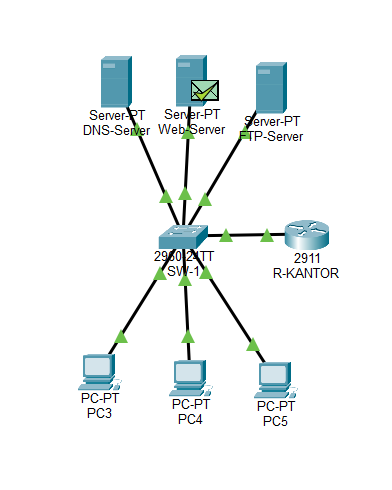

# Project 2: Jaringan Kantor dengan DHCP, DNS, Web, dan FTP

## Deskripsi Proyek

Proyek ini membangun jaringan LAN kantor kecil menggunakan Cisco Packet Tracer. Jaringan menjalankan empat layanan utama, yaitu DHCP pada router serta DNS, HTTP, dan FTP pada server yang terpisah.

Pengujian dilakukan dari PC klien. Alur komunikasi jaringan, seperti ARP, DNS, TCP, dan HTTP, juga dianalisis menggunakan Simulation Mode.

## Tujuan

- Membangun jaringan LAN menggunakan satu router, satu switch, beberapa PC klien, dan tiga server.
- Mengonfigurasi DHCP pada router agar klien mendapatkan alamat IP, gateway, dan DNS secara otomatis.
- Mengonfigurasi layanan DNS, HTTP, dan FTP pada server dengan alamat IP statis.
- Menganalisis proses ARP, DNS, TCP handshake, dan HTTP menggunakan Simulation Mode.

## Tools

- Cisco Packet Tracer 9.0.1

## Topologi Jaringan



| Perangkat | Jenis | Keterangan |
|---|---|---|
| R-KANTOR | Router 2911 | Gateway dan server DHCP |
| SW-1 | Switch 2960 | Menghubungkan seluruh perangkat jaringan |
| PC1–PC3 | PC klien | Mendapatkan alamat IP melalui DHCP |
| DNS-Server | Server | Menyediakan layanan DNS |
| Web-Server | Server | Menyediakan layanan web melalui HTTP |
| FTP-Server | Server | Menyediakan layanan transfer file melalui FTP |

## Skema Pengalamatan IP

Jaringan yang digunakan adalah `192.168.2.0/24`.

| Perangkat | Alamat IP | Subnet Mask | Gateway | DNS |
|---|---|---|---|---|
| R-KANTOR (Gig0/0) | `192.168.2.1` | `255.255.255.0` | - | - |
| DNS-Server | `192.168.2.10` | `255.255.255.0` | `192.168.2.1` | `192.168.2.10` |
| Web-Server | `192.168.2.11` | `255.255.255.0` | `192.168.2.1` | `192.168.2.10` |
| FTP-Server | `192.168.2.12` | `255.255.255.0` | `192.168.2.1` | `192.168.2.10` |
| PC klien | DHCP, mulai dari `192.168.2.100` | `255.255.255.0` | `192.168.2.1` | `192.168.2.10` |

Rentang alamat IP `192.168.2.1` sampai `192.168.2.99` dikecualikan dari DHCP pool untuk menyediakan alamat khusus bagi router dan server.

## Implementasi

### 1. Konfigurasi Router dan DHCP

Konfigurasi lengkap router tersedia di `config/router-kantor-config.txt`.

Konfigurasi utama meliputi:

- Memberikan alamat IP `192.168.2.1/24` pada interface `GigabitEthernet0/0`.
- Mengaktifkan interface menggunakan perintah `no shutdown`.
- Mengecualikan alamat IP cadangan menggunakan `ip dhcp excluded-address 192.168.2.1 192.168.2.99`.
- Membuat DHCP pool bernama `KANTOR` untuk jaringan `192.168.2.0/24`.
- Menetapkan gateway `192.168.2.1`.
- Menetapkan DNS server `192.168.2.10`.

### 2. Konfigurasi Server

| Server | Konfigurasi |
|---|---|
| DNS-Server | Mengaktifkan layanan DNS dan menambahkan record A `www.kantor.local` yang mengarah ke `192.168.2.11`, serta `ftp.kantor.local` yang mengarah ke `192.168.2.12`. |
| Web-Server | Mengaktifkan layanan HTTP dan mengubah isi halaman `index.html`. |
| FTP-Server | Mengaktifkan layanan FTP dan membuat akun `ftpuser` dengan izin akses penuh. |

Kata sandi FTP digunakan khusus untuk keperluan praktikum di Cisco Packet Tracer.

### 3. Konfigurasi PC Klien

Seluruh PC klien diatur menggunakan mode DHCP melalui menu IP Configuration. Dengan pengaturan ini, PC mendapatkan alamat IP, subnet mask, gateway, dan DNS secara otomatis.

## Pengujian dan Verifikasi

Pengujian dilakukan melalui PC klien untuk memastikan seluruh layanan berjalan sesuai konfigurasi.

| No. | Pengujian | Hasil yang Diharapkan | Hasil Aktual | Bukti |
|---|---|---|---|---|
| 1 | DHCP menggunakan `ipconfig /all` | IP mulai dari `192.168.2.100`, gateway `192.168.2.1`, dan DNS `192.168.2.10` | Belum diisi | `screenshots/03-ipconfig-all-pc1.png` |
| 2 | `ping 192.168.2.1` | Mendapatkan balasan dari gateway | Belum diisi | `screenshots/04-ping-gateway.png` |
| 3 | `ping 192.168.2.11` | Mendapatkan balasan dari Web-Server | Belum diisi | `screenshots/05-ping-webserver.png` |
| 4 | `nslookup www.kantor.local` | Menghasilkan alamat IP `192.168.2.11` | Belum diisi | `screenshots/06-nslookup.png` |
| 5 | Mengakses `http://www.kantor.local` melalui browser | Halaman web kustom berhasil ditampilkan | Belum diisi | `screenshots/07-browser-web.png` |
| 6 | Mengakses `ftp ftp.kantor.local`, login, lalu menjalankan `dir` | Login berhasil dan daftar file ditampilkan | Belum diisi | `screenshots/08-ftp-login.png` |

Status interface router juga diverifikasi menggunakan perintah `show ip interface brief`.

Bukti pengujian: `screenshots/02-show-ip-interface-brief.png`.

## Analisis Simulation Mode

Analisis dilakukan dari PC3 setelah cache ARP dikosongkan menggunakan perintah `arp -d`. Selanjutnya, PC3 mengakses `http://www.kantor.local` dengan filter ARP, DNS, TCP, dan HTTP yang diaktifkan.

### Bukti Simulasi


### Urutan Komunikasi yang Diamati

| Tahap | Protokol | Proses |
|---|---|---|
| 1 | ARP | PC3 mengirimkan ARP broadcast untuk mencari alamat MAC DNS-Server. Switch meneruskan broadcast dan DNS-Server memberikan balasan. |
| 2 | DNS | PC3 mengirimkan permintaan untuk `www.kantor.local`. DNS-Server membalas dengan alamat IP Web-Server. |
| 3 | ARP | PC3 mencari alamat MAC Web-Server sebelum mengirimkan paket ke server tersebut. |
| 4 | TCP | PC3 dan Web-Server membangun koneksi melalui proses SYN, SYN-ACK, dan ACK. |
| 5 | HTTP | PC3 mengirimkan permintaan GET. Web-Server membalas dengan halaman web yang diminta. |
| 6 | TCP | Koneksi TCP ditutup setelah komunikasi selesai. |

Urutan tersebut sesuai dengan mekanisme komunikasi jaringan. ARP membantu menemukan alamat MAC perangkat tujuan di jaringan lokal. DNS menerjemahkan nama domain menjadi alamat IP. TCP membangun koneksi sebelum HTTP mengirimkan permintaan dan menerima halaman web.

Permintaan DNS dapat terlihat berdekatan dengan aktivitas ARP pada Event List karena PC3 dapat menyiapkan permintaan DNS sebelum proses resolusi alamat MAC selesai.

## Pemetaan Protokol ke Lapisan OSI

| Lapisan OSI | Protokol dan Komponen |
|---|---|
| Lapisan 7: Application | DHCP, DNS, HTTP, FTP |
| Lapisan 4: Transport | UDP untuk DHCP dan DNS, TCP untuk HTTP dan FTP |
| Lapisan 3: Network | IP dan router |
| Lapisan 2: Data Link | Ethernet, alamat MAC, ARP, dan switch |

## Struktur Folder Proyek

```text
02-layanan-kantor/
├── README.md
├── jaringan-kantor.pkt
├── config/
│   └── router-kantor-config.txt
└── screenshots/
    ├── 01-topologi.png
    ├── 02-show-ip-interface-brief.png
    ├── 03-ipconfig-all-pc1.png
    ├── 04-ping-gateway.png
    ├── 05-ping-webserver.png
    ├── 06-nslookup.png
    ├── 07-browser-web.png
    ├── 08-ftp-login.png
    ├── 09a-simulation-bagian-1.png
    └── 09b-simulation-bagian-2.png
```

## Kesimpulan

Proyek ini menerapkan jaringan LAN kantor menggunakan Cisco Packet Tracer dengan layanan DHCP, DNS, HTTP, dan FTP. DHCP menyediakan konfigurasi IP otomatis, DNS menerjemahkan nama domain, HTTP menyediakan akses ke halaman web, dan FTP mendukung transfer file.

Simulation Mode digunakan untuk mengamati proses komunikasi antarperangkat dan memahami hubungan antara ARP, DNS, TCP, dan HTTP dalam mengakses layanan jaringan.
